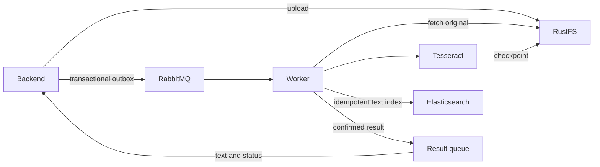

# OCR worker

The standalone Python service consumes the backend's JSON upload messages from
`paperless.ocr.requests`, retrieves the original from the private RustFS bucket,
and runs Tesseract. Poppler renders PDF pages individually; Pillow handles PNG,
JPEG, TIFF (including multiple frames), BMP, and WebP. UTF-8 plain text bypasses OCR.
The image includes English and German language data. Configure the installed
languages with `OCR_LANGUAGES` (default `eng+deu`).



One worker service handles one delivery at a time. OCR runs on a background
thread, leaving the Pika connection thread free to serve heartbeats and perform
all AMQP operations. The worker uses manual acknowledgements, persistent messages,
mandatory routing, and publisher confirmations. It reconnects after broker loss.
SIGTERM stops intake and leaves unfinished deliveries available for redelivery.
The image runs as a non-root user and reports health from its connection heartbeat.

Completed OCR output is saved to `ocr-results/<jobId>.json` in RustFS. The checkpoint
includes the job ID, document ID, source key, content type, text, and extraction time.
Redeliveries validate and reuse this output. A successful result event contains the
same fields plus `status: COMPLETED`; failures use `status: FAILED` and a safe error
code. The backend's result service updates document text/status using domain
persistence and preserves ownership, team membership, metadata, and version checks.

Transient failures are republished to a durable delay queue before acknowledging
the original. `OCR_MAX_ATTEMPTS=3` counts the original attempt, and
`OCR_RETRY_DELAY_MS=10000` sets the delay. Invalid messages are rejected immediately.
Unsupported or corrupt documents, missing source objects, and exhausted attempts
are sent to the dead-letter queue `paperless.ocr.failed`. Valid failed jobs also
publish a failure result. Replaying a dead-lettered request after recovery reuses
any existing OCR checkpoint.

The default limits are 50 MiB input, 100 pages, 20 million pixels per image, 60
seconds per OCR/render operation, and two million extracted characters. PDFs are
rendered one page at a time at a maximum dimension of 2400 pixels. Temporary files
are removed after each document. Logs contain job/document IDs and exception types,
never filenames, document contents, exception messages, or credentials.

## Run

From the repository root:

```bash
docker compose --env-file .env.local up --build -d
docker compose --env-file .env.local logs -f ocr-worker
```

The service uses `RABBITMQ_HOST/PORT/USER/PASS`, `S3_ENDPOINT/REGION/BUCKET`, and
`RUSTFS_ACCESS_KEY/SECRET_KEY`. Compose supplies internal service addresses.
No database credentials or direct database access are needed by the worker.

## Verify

With Python 3.13, Tesseract English language data, and Poppler installed:

```bash
python -m venv .venv
.venv/bin/pip install -r requirements.txt
.venv/bin/python -m unittest discover -s tests -v
```

Unit tests cover request validation, checkpoints, bounded retries, publication
confirmation, and acknowledgement ordering. The OCR tests recognize actual image
and two-page PDF content; they skip if the local OCR engine/language data is absent.
Worker CI installs those prerequisites and runs the tests before building the image.

For a live broker/storage check, configure the normal environment variables for
running RabbitMQ and RustFS, then run:

```bash
PYTHONPATH=. .venv/bin/python tests/integration_smoke.py
```

This creates a randomly named private bucket, exchanges, and queues, starts its own
worker process, checks PDF OCR, checkpoint reuse on duplicate delivery, and dead-letter
routing, checks Elasticsearch document content/full-text search and duplicate indexing,
and removes only those test resources. It does not consume the application's
queues. From a worker container with the tests mounted, use `PYTHONPATH=/app` instead.

## Indexing and worker layout

One worker service is sufficient for the current pipeline. It checkpoints OCR in
RustFS, indexes the extracted text with `PUT /<index>/_doc/<documentId>`, confirms
the backend result event, and then acknowledges the request. Elasticsearch failure
leaves the checkpoint intact; a retry repeats only indexing and result publication.
This also lets a dead-lettered job be replayed after a longer outage without OCR.
The index is created with explicit mappings; creation races between instances are
handled. The document ID is stable across all deliveries.

This avoids a second broker handoff and a second service to operate at the current
volume. Separate OCR and indexing consumers become useful if they need independent
scaling, indexing outages must not delay new OCR, or additional consumers need OCR
output. The existing RustFS checkpoint is the durable handoff for that future split.
No text is carried in upload requests; the worker alone retrieves source bytes.

`ELASTICSEARCH_URL` defaults to `http://localhost:9200` for native runs and is
overridden with the internal endpoint by Compose. `ELASTICSEARCH_INDEX` defaults
to `paperless-documents`. Native/remote secured clusters can use
`ELASTICSEARCH_USER` and `ELASTICSEARCH_PASSWORD`; HTTPS uses the system trust store.
The Compose development cluster uses no authentication and exposes only loopback
host ports. The backend continues to enforce document authorization.

The document index stores `document_id`, `job_id`, `storage_key`, `content_type`,
`text`, and `extracted_at`. REST document text/status is updated through the result
queue as before; REST search continues to use its existing visibility-filtered
database queries. Index deletion/retention must be managed separately from REST
document deletion; lifecycle synchronization is not part of these worker tasks.

JSON log events go to stdout and, when `WORKER_LOG_PATH` is set, rotating files
(5 MiB each, three backups). Compose shares the log volume with Logstash read-only.
Logstash tails the active file and persists offsets separately; stable event IDs
prevent duplicates after a log line is replayed. Kibana can inspect both document
and log indices. Logging is independent of the indexing path, so a Logstash outage
does not fail an OCR job; files buffer recent events until ingestion resumes.

The worker tests include an HTTP-level Elasticsearch contract check and verify
that indexing failures preserve the checkpoint and retries do not call OCR again.
The live smoke test additionally requires Elasticsearch and creates its own
randomly named document index, removed during cleanup.
